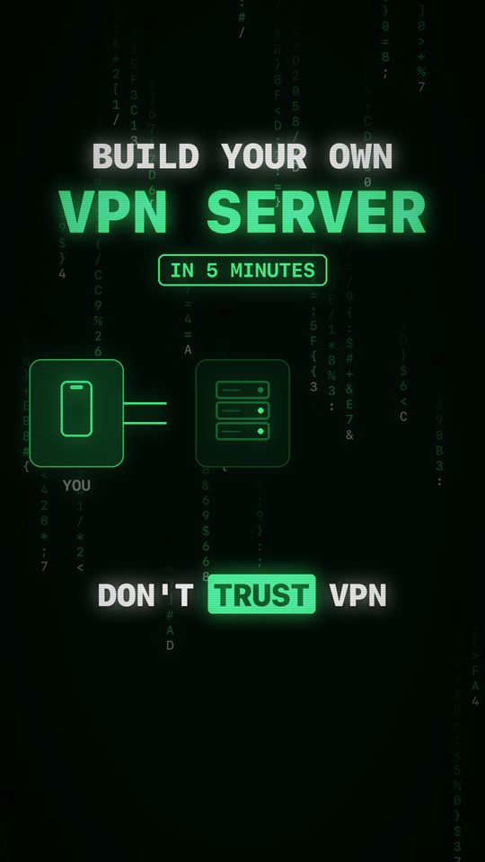

# Build your own VPN server in 5 minutes



Your own WireGuard VPN on a ~$5/month server: no VPN company in the middle, and only your devices connect to it.

From the TikTok video by [@andriu.lo](https://www.tiktok.com/@andriu.lo).

## What you need

- A VPS from any provider (Hetzner, DigitalOcean, Vultr, Linode and so on): **Ubuntu 22.04/24.04 or Debian 11+**, 1 vCPU and 1 GB RAM are plenty
- The **WireGuard** app on your phone or laptop (iOS, Android, macOS, Windows, Linux)

## Steps

**1. Rent a VPS** and note its public IP address.

**2. SSH into it as root:**

```bash
ssh root@YOUR_SERVER_IP
```

**3. Run the installer:**

```bash
bash <(curl -fsSL https://raw.githubusercontent.com/tvcregion/vpn-in-5-minutes/main/install.sh)
```

Press Enter to accept the defaults, then type a name for your device (for example `phone`).
When it finishes, the installer prints a **QR code**.

**4. Connect:** in the WireGuard app tap **+** → **Scan from QR code**, scan it, and flip the switch on.
Done: your traffic now leaves the internet from your server's IP.

## More devices, removing devices, uninstalling

Run the same command again. It opens a menu:

```
1) Add a new user
2) List all users
3) Revoke existing user
4) Uninstall WireGuard
```

Every device gets its own config and QR code. On a laptop you can import the file
`/root/wg0-client-<name>.conf` instead of scanning.

## Troubleshooting

- **The app says connected, but nothing loads.** Open the WireGuard **UDP** port in your provider's
  firewall panel. The installer prints the port at the end, and it's also in `/etc/wireguard/params` as `SERVER_PORT`.
  If `ufw` is active on the server, the script already opens the port there.
- **Still no internet through the VPN?** Reboot the server once: `reboot`.
- **Check the server side:** `systemctl status wg-quick@wg0` and `wg show`.

## What the script does

[`install.sh`](install.sh) is a short wrapper you can read in a minute. It:

1. downloads [angristan/wireguard-install](https://github.com/angristan/wireguard-install), pinned to commit
   [`832fb98`](https://github.com/angristan/wireguard-install/tree/832fb9833501a7220e2900cffb61082841dedba8),
2. **checks its SHA-256** and refuses to run if the file was changed,
3. runs it, which installs WireGuard, generates keys, sets up NAT and creates your first device,
4. opens the port in `ufw` if `ufw` is enabled.

To check the download without installing anything (works on macOS too):

```bash
bash <(curl -fsSL https://raw.githubusercontent.com/tvcregion/vpn-in-5-minutes/main/install.sh) --verify-only
```

## Good to know

- The QR code and the `.conf` file contain your device's **private key**. Don't post or share them.
- Keep the server updated: `apt update && apt upgrade -y`.
- Your VPS provider can still see the server's traffic metadata, just like your ISP did before.
  Pick a provider and server location you trust.
- Use it within the laws of your country and your provider's terms of service.

## Credits

The heavy lifting is done by [angristan/wireguard-install](https://github.com/angristan/wireguard-install)
(MIT License, © angristan). WireGuard® is a registered trademark of Jason A. Donenfeld.

## License

[MIT](LICENSE)
